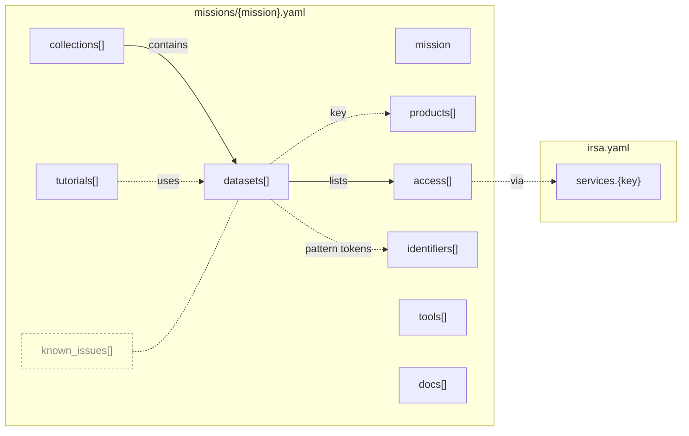

# IRSA Knowledge Map

Simple YAML describing how to discover and access mission data at IRSA. It's meant to feed JupyterBook-based web pages, llms.txt, skills and an MCP server.

For each mission it records which SIA collections, TAP tables, S3 prefixes, coverage maps (MOCs), DOIs, file patterns and tutorials belong to each data product, which releases are current, and what to watch out for. Service names, S3 prefixes and links are checked against IRSA's live services on every pull request and weekly; DOIs, dates and statuses are curated by hand.

## What this is and isn't

**IRSA's services are the source of truth for what exists.** An SIA/SSA collection or TAP table exists if `Irsa.list_collections()` / `Irsa.list_catalogs()` list it, and a path exists if S3 or IRSA serves it. This map doesn't override them: validation fails when a service name or S3 prefix it lists is missing live, and discovery reports what IRSA has that the map doesn't.

**This map is the source of truth for what those things mean and how they connect**, which no service records:
- which SIA collection, TAP table, S3 prefix, MOC, DOI and file pattern belong to the same product;
- that a product in one release is the same product in another;
- each release's status (`available`, `partial`, `planned`, `retired`) and what it does *not* have;
- data reachable only by browsing (FITS-only catalogs, tarballs, folder layouts);
- caveats, known issues, and the docs and tutorials for each product.

Names appear here only as the keys that tie these together. Anything a service already describes well, such as column lists or table descriptions, is queried, not copied.

In practice: **use astroquery or pyvo to run queries; use this map to know which names to query, in which release, and with what caveats.**

## Terms

- **Collection:** a group of a mission's datasets in this map, usually a release (Euclid Q1, SPHEREx QR3). Not the same as an IRSA SIA/SSA "collection" such as `euclid_DpdMerBksMosaic`, which appears here only as an access entry's `name`.
- **Dataset:** one product in one collection, e.g. `euclid.q1.mer-catalog`.
- **Product key:** the last part of a dataset id (`mer-catalog`). It stays the same across collections. Euclid's keys start with the pipeline or instrument that makes them: `mer-` multiwavelength mosaics and catalogs, `phz-` photometric redshifts, `spe-` spectroscopic redshifts and lines, `sir-` slitless spectra, `vis-` the VIS imager, `nir-` the NISP near-infrared imager.
- **Browse / `/ibe/data/`:** IRSA's on-premises file tree, browsable over HTTP.
- **Validation / discovery:** the two automated checks (see [Checks](#checks)): validation confirms what the map says; discovery finds what it doesn't have yet.

## Using it

Read the files straight from GitHub:
- `https://raw.githubusercontent.com/jaladh-singhal/irsa-knowledge-map/main/missions/<mission>.yaml` (`euclid`, `spherex`)
- `https://raw.githubusercontent.com/jaladh-singhal/irsa-knowledge-map/main/irsa.yaml` (shared services)

`km_lookup.py` is a small example helper for reading them. It needs only `pyyaml`, and reads GitHub by default, or a local checkout or branch via `source=` or the `KM_SOURCE` environment variable:

```python
from km_lookup import load, names, products, tutorials
euclid = load("euclid")                      # or load("euclid", source="path/to/checkout")
names(euclid, "q1", "mer-catalog", "tap")    # ['euclid_q1_mer_catalogue']
names(euclid, "q1", "mer-catalog", "moc")    # the catalog's coverage map URL
tutorials(euclid, "q1", "mer-catalog")       # tutorials using it, each with page url and raw source_url
products(euclid)                             # every product key, e.g. "phz-photo-z", "sir-spectra"
```

A wrong product key returns `[]`, so list the keys with `products()` first (prefixes are explained under [Terms](#terms)).

**Not listed means not confirmed, not "doesn't exist".** Discovery reports new IRSA data weekly, and it reaches the map once someone adds it. If something isn't here, check IRSA live (`Irsa.list_collections`, `Irsa.list_catalogs`) rather than guessing a name.

## How it's organized

```
irsa.yaml              # shared services (SIA, SSA, TAP, SCS, cutout, browse, s3, hats, gui, script, moc) and tutorials repo
missions/
  euclid.yaml          # ERO, Q1, Q2, DR1 (planned)
  spherex.yaml         # QR3, QR2, QR1 (retired), DR1 (planned), SPLICES, 3I/ATLAS, lab spectral calibrations
km_lookup.py           # example helper (see Using it)
scripts/               # validate_facts.py, discover_facts.py (see Checks)
```

A mission file has a `mission` block, a `products` list, and `collections`, each holding `datasets`, each listing `access` entries:



Solid arrows are nesting in the YAML; dotted arrows are references by id or key. `mission`, `tools` and `docs` stand alone. `known_issues` (faded) annotate collections or datasets through `affects`.

- **Collections** group a mission's datasets. Each has a `kind`: `release` (Euclid Q1, SPHEREx QR3, …), `ancillary` (supporting data, e.g. SPLICES), `target_view` (one target's observations, e.g. 3I/ATLAS) or `contributed` (products made by others). Its `status` is `available`, `partial` (still being rolled out), `planned` or `retired`, and `cadence` is `once` or `weekly` (rolling releases).
- **Dataset ids** are `<mission>.<collection>.<product>`, e.g. `euclid.q1.mer-catalog`. A dataset usually holds one TAP table; tables shared across releases (e.g. SPHEREx's `spherex.plane`) are repeated in each release's dataset.
- **Product keys** stay the same in every collection that has the product, so code can ask for "the `mer-catalog` of release X" without knowing each release's table names. Each mission declares its keys in `products`.
- **Access entries** are `{via, name}`: `via` is a service key from `irsa.yaml` (`sia`, `tap`, `s3`, `moc`, …) and `name` is what that service calls the product. Readers can treat a service key as a dataset field (the JupyterBook plugin's `` {km}`tap euclid.q1.mer-catalog` `` reads `access`), so no mission, collection or dataset field may be named after a service key; validation checks this.
- **A release's own `access`** lists its roots (its on-prem browse folder, S3 prefix and the bucket's `s3_browser` page, the `index.html` IRSA puts in each bucket), in the same `{via, name}` form; discovery ignores them, so new folders under a root are still reported.
- **Tutorials** are IRSA's CI-tested notebooks, the most current source for *how* to access a product. Each has its page `url`, a `source` path in [irsa-tutorials](https://github.com/Caltech-IPAC/irsa-tutorials) (`irsa.yaml`'s `tutorials.source_prefix` + `source` is the raw notebook), and `uses`, the datasets it demonstrates.

Entries in `tutorials`, `tools`, `identifiers` and `docs` each have an `id` too, its path like a dataset's, so anything can be referred to the same way (e.g. `euclid.tools.gator`); a tutorial's id ends in its page's slug.

Two links are by name only and not checked: `{tokens}` in a file `pattern` correspond to `identifiers` (e.g. `{planning_period}`), and `via: gui` entries usually name a tool from `tools`.

## Editing it

**Rules**
- **Store only what routes to data:** names, dates, status, DOIs, service names, paths and file patterns. Link to everything else.
- **Don't type numbers that change with each release or ingest:** no counts, volumes, released areas or "last updated" dates. Fixed design values, such as a survey's planned area, are fine.
- **Each fact appears once:** services are defined in `irsa.yaml` and referenced by key; browse and S3 locations live in `access`, and `files` holds only the file `pattern`.
- **Every collection has `status` and `as_of`**, the date its values were last checked against their sources.

**Conventions**
- **Conflicts:** where sources disagree, use the live-page or tutorial value and leave a comment naming the alternative.
- **Unknown values:** leave them blank with a `TODO`; never guess.
- **Dates:** `launch` is UTC; `released` may be `YYYY-MM` when only the month is known.
- **Citations:** no acknowledgement text; the collection's `overview` page and DOIs carry it.

**New release checklist** (a one-off release like Euclid DR1, or a weekly one like a new SPHEREx QR):
1. Start from the "New IRSA facts to triage" issue, which lists the new collections, tables and S3 prefixes discovery found.
2. Add or update the release's collection: `status`, `released`, `cadence`, `overview`, `doi`, `notes` and `as_of`. Copying the previous release's collection is the quickest start.
3. Add a dataset per product, copying the shape of the same product in the previous release (`id`, `name`, `type`, `doi`, `access`, `files`, `docs`) and reusing its key: `euclid.dr1.mer-catalog` with `{via: tap, name: <DR1 table>}`, and so on. Repeat tables shared across releases (e.g. `spherex.plane`) in the new datasets.
4. Update the previous release if it changes: its `status` (e.g. `retired`), `cadence`, and notes such as "use caution combining with QR4".
5. For a new S3 bucket, add its `via: s3` entries (discovery only searches buckets the map already lists). For a new `/ibe/data/` folder, map it to its S3 copy in `IBE_TO_S3` in `scripts/validate_facts.py`, or validation warns that it can't check it.
6. Add the release to the tutorials' `uses`, update the file listing under [How it's organized](#how-its-organized), and clear any Open TODO it resolves.

**Changing the YAML's shape** (or moving this repo) means updating the code that reads it. Each reader is a thin lookup with no rules of its own:
- `km_lookup.py`, used by `scripts/`;
- its copy in the [euclid-data-access skill](https://github.com/IPAC-SW/irsa-datascience/tree/main/irsa-skills/skills/euclid-data-access)'s `scripts/` (re-sync by hand);
- `plugins/src/km-lookup.mjs` in [euclid-archive-documentation](https://github.com/Caltech-IPAC/euclid-archive-documentation), the JupyterBook site's reader (same function names).

**Adding a product.** Reuse the existing product key for the same product; declare a new key in `products` only for a new product. A shared key promises the same kind of product, not the same file layout or columns, which stay per dataset. A collection that lacks a product simply has no dataset for it. Tutorials filed under another mission's or a general section (e.g. "Techniques and Tools") have to be added by hand.

## Checks

- **Validation** (`scripts/validate_facts.py`, on PRs that touch the data and weekly) checks every access entry live (TAP tables and SIA/SSA collections via astroquery, S3 and HATS prefixes via s3fs), that every link responds, that every product key is declared, that every tutorial, tool, identifier and doc has a unique `id` under its section, that no field is named after a service key, and that every tutorial is still listed in irsa-tutorials' `notebook_metadata.yml`. `/ibe/data/` paths are checked through their S3 copy, and URLs disallowed by IRSA's robots.txt are skipped. Failures are re-checked once after 30 s. Not checked: DOIs, dates, statuses, file patterns, `gui`/`script`/`cutout` entries, and access entries marked `status: planned`.
- **Discovery** (`scripts/discover_facts.py`, weekly) does the reverse: it lists SIA/SSA collections, TAP tables, the first two levels of S3 folders in buckets the map already lists, and notebooks in each mission's tutorial section that the map doesn't have yet, each with a YAML line ready to paste, in one rolling issue, "New IRSA facts to triage".

To run them locally from the repo root (Python 3.9+, network access):

```sh
python3 -m venv .venv && source .venv/bin/activate       # first time: create; later: just activate
pip install pyyaml requests astroquery s3fs             # first time only
python scripts/validate_facts.py                        # add -v to list every check
python scripts/discover_facts.py
```

## Open TODOs

- Euclid DR1 `released` (2026-10-21) comes from a search snippet only; verify it once DR1 is announced.
- Whether SPHEREx QR2 still gets weekly ingest now that QR3 is live (`cadence`).
- Unify the three readers (see [Editing it](#editing-it)), which today repeat the same lookups by hand. Options:
  - Package `km_lookup.py` (pip), so the skill and other Python code depend on it instead of a copy.
  - Publish the JavaScript reader the same way (npm), for JupyterBook sites.
  - Have this repo's CI publish a flattened JSON index (one row per access entry: mission, collection, product, via, name), so every reader becomes a plain filter with almost no logic to duplicate.
- Access entries' `name` (what the service calls the dataset) shares its key with a dataset's display `name`; consider renaming it (e.g. `as`), which means updating all three readers.
- Whether CI may query `/ibe/data/` (robots.txt disallows crawlers there). Until decided, `browse` paths are checked via their S3 copy.

---

<sub>**Provenance.** The initial values came from source inventories crawled on 2026-09-30 (Euclid) and 2026-10-05 (SPHEREx); those dates remain as `as_of` on collections not yet re-checked. Collections with a later `as_of` were re-checked against live IRSA services (SIA, SSA, TAP_SCHEMA, S3 listings, the MOC directory and overview pages).</sub>
