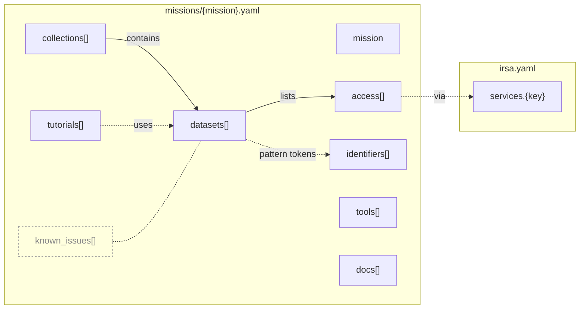

# IRSA Knowledge Map

Simple YAML describing how to discover and access mission data at IRSA. It's meant to feed JupyterBook-based web pages, llms.txt, skills and an MCP server.

```
irsa.yaml              # shared services (SIA, SSA, TAP, SCS, cutout, browse, s3, hats, gui, script, moc) + tutorials source_prefix
missions/
  euclid.yaml          # ERO, Q1, Q2, DR1 (planned)
  spherex.yaml         # QR3, QR2, QR1 (retired), DR1 (planned), SPLICES, 3I/ATLAS, lab spectral calibrations
km_lookup.py           # example helper for reading the files (see Reading it from code)
scripts/               # validate_facts.py, discover_facts.py (see Validation)
```

## What this is and isn't

**IRSA's services are the source of truth for what exists.** A collection or table exists if `Irsa.list_collections()` / `Irsa.list_catalogs()` (SIA, SSA, TAP) list it, and a path exists if S3 or IRSA serves it. This map never overrides them: validation fails if it names anything they don't have, and discovery reports anything they have that it doesn't.

**This map is the source of truth for what those things mean and how they connect**, which no service records:
- which SIA collection, TAP table, S3 prefix, MOC, DOI and file pattern belong to the same product;
- that a product in one collection (e.g. a release) is the same product in another (stable product keys);
- each collection's kind and status (current, planned, retired, superseded) and what it does *not* have;
- data reachable only by browsing (FITS-only catalogs, tarballs, folder layouts);
- caveats, known issues, and the docs and tutorials for each product.

Names appear here only as the keys that tie these together. Anything a service already describes well, such as column lists or table descriptions, is linked or queried, not copied.

## How the pieces connect



**Solid arrows mean nesting in the YAML; dotted arrows mean a reference by id or key**. `mission`, `tools` and `docs` are standalone: each holds its own facts and links, and no id points to them. `known_issues` (faded) is an annotation layer: each entry's `affects` names the collections or datasets it applies to.

Two links are by name only, so nothing checks them yet: `{tokens}` in a filename `pattern` correspond to `identifiers` (e.g. `{planning_period}` ↔ Planning Period), and `access` entries with `via: gui` usually name a tool from `tools`. Some instead name Gator or a Data Collection Explorer id such as `euclid_q2`.

IDs are hierarchical (`<mission>.<collection>.<product>`, e.g. `euclid.q1.mer-mosaic`), so `affects` and `uses` can name either a whole collection or one dataset.

**Collections** group a mission's datasets. Each has a `kind`: `release` (Euclid Q1, SPHEREx QR3, …), `ancillary` (e.g. SPLICES), `target_view` (e.g. 3I/ATLAS) or `contributed`. A collection here is not an SIA/SSA "collection" such as `euclid_DpdMerBksMosaic`; those appear only as an access entry's `name`.

**Tutorials** are IRSA's CI-tested notebooks, the most current source for *how* to access a product. Each mission's `tutorials` entry has the published `url`, its `source` path in [irsa-tutorials](https://github.com/Caltech-IPAC/irsa-tutorials), and `uses` (the dataset ids it demonstrates). `irsa.yaml`'s `tutorials.source_prefix` + `source` is the raw notebook. Validation checks each tutorial is still listed in irsa-tutorials' `notebook_metadata.yml`; discovery reports new notebooks in a mission's section (notebooks filed under another section, like "Techniques and Tools", are added by hand).

`km_lookup.py` follows exactly these links; see [Reading it from code](#reading-it-from-code).

### Product keys

**A product keeps the same key in every collection that has it**, so code and docs can ask for "the `mer-catalog` of collection X" without naming each collection's tables. Each mission file declares its keys in a top-level `products:` list, and validation fails on a dataset whose key isn't declared. One dataset holds one TAP table. A shared key promises the same kind of product, not the same file layout or columns; those stay per dataset. A product only some collections have gets its own key, and a collection without a product simply has no dataset for it. When a new collection arrives, reuse the existing key for the same product and declare a new one only for a new product.

## Reading it from code

`km_lookup.py` is a small example of walking the files: collection → dataset → `access` entries, with `via` resolved through `irsa.yaml`. It needs only `pyyaml` and reads the raw GitHub files by default, or a local checkout:

```python
from km_lookup import load, names, tutorials
euclid = load("euclid")                             # or load("euclid", source="path/to/checkout")
names(euclid, "q1", "mer-catalog", "tap")           # ['euclid_q1_mer_catalogue']
tutorials(euclid, "q1", "mer-catalog")              # tutorials using it, each with url and source_url
```

## Rules

- **Store only what routes to data:** names, dates, status, DOIs, service names, paths and filename patterns. Link to everything else.
- **Don't type numbers that change:** leave out counts, volumes, coverage and "last updated" dates.
- **Each fact appears once:** services are defined in `irsa.yaml`, and missions refer to them by key in `access[].via`. Browse and S3 locations live in `access`; `files` holds only the filename `pattern`.
- **Every record has `status` and `as_of`:** `as_of` is the date the values were last checked against their sources.

## Conventions

- **Conflicts:** where sources disagree, the file uses the live-page or tutorial value and leaves a comment naming the alternative.
- **Unknown values:** these are left blank with a `TODO`, never guessed.
- **Dates:** `launch` is UTC. `released` may be `YYYY-MM` when sources give only the month.
- **Citations:** no acknowledgement text is stored. Collection `overview` pages and DOIs carry it.

## Validation

`scripts/validate_facts.py` checks every access entry and link against live IRSA services. It runs on PRs that touch `irsa.yaml` or `missions/`, and weekly. To run it locally from the repo root:

```sh
python3 -m venv .venv                 # first time only
source .venv/bin/activate
pip install pyyaml requests astroquery s3fs   # first time only
python scripts/validate_facts.py      # add -v to list every check, not just problems
```

`scripts/discover_facts.py` does the reverse: it lists SIA/SSA collections, TAP tables, the first two levels of S3 prefixes, and notebooks in the mission's section of irsa-tutorials' `notebook_metadata.yml` that IRSA has but the knowledge map doesn't, with a YAML line ready to paste. It runs weekly and keeps one rolling issue, "New IRSA facts to triage", up to date (closed when there's nothing new). Run it locally the same way: `python scripts/discover_facts.py`.

## Open TODOs

- Euclid DR1 `released` (2026-10-21) comes from a search snippet only; verify it once DR1 is announced.
- Whether SPHEREx QR2 still gets weekly ingest now that QR3 is live (`cadence`).
- Graduate `km_lookup.py` to a pip-installable package once more than the skill and scripts use it (JB build, MCP server).
- Whether live-service CI checks may query `/ibe/data/` (robots.txt disallows crawlers there). Until decided, check `browse` paths via their S3 mirror.

---

<sub>**Provenance.** The initial values were seeded from source inventories crawled on 2026-09-30 (Euclid) and 2026-10-05 (SPHEREx); those dates remain as `as_of` on records not yet re-checked. Records with a later `as_of` were re-checked against live IRSA services (SIA, SSA, TAP_SCHEMA, S3 listings, the MOC directory and overview pages).</sub>
