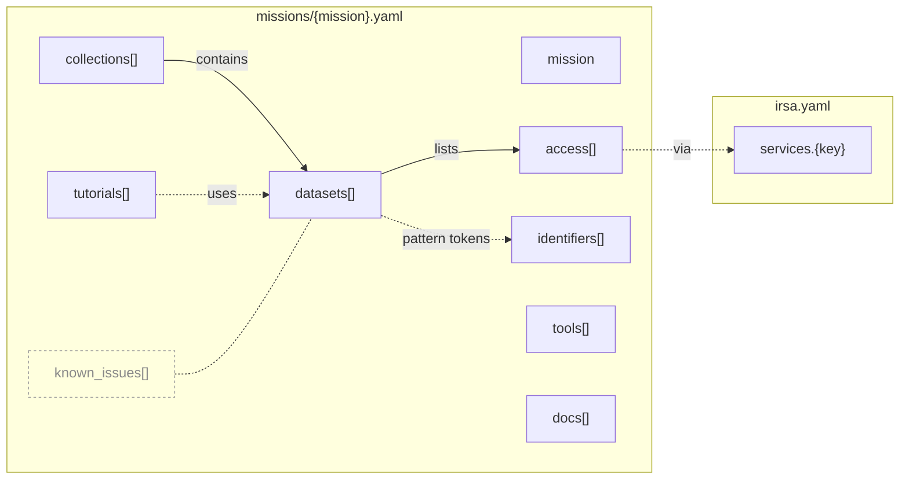

# IRSA Knowledge Map

Simple YAML describing how to discover and access mission data at IRSA. It's meant to feed JupyterBook-based web pages, llms.txt, skills and an MCP server.

```
irsa.yaml              # shared services (SIA, SSA, TAP, SCS, cutout, browse, s3, hats, gui, script)
missions/
  euclid.yaml          # ERO, Q1, Q2, DR1 (planned)
  spherex.yaml         # QR3, QR2, QR1 (retired), DR1 (planned), SPLICES, 3I/ATLAS, lab spectral calibrations
```

## How the pieces connect



**Solid arrows mean nesting in the YAML; dotted arrows mean a reference by id or key**. `mission`, `tools` and `docs` are standalone: each holds its own facts and links, and no id points to them. `known_issues` (faded) is an annotation layer: each entry's `affects` names the collections or datasets it applies to.

Two links are by name only, so nothing checks them yet: `{tokens}` in a filename `pattern` correspond to `identifiers` (e.g. `{planning_period}` ↔ Planning Period), and `access` entries with `via: gui` usually name a tool from `tools`. Some instead name Gator or a Data Collection Explorer id such as `euclid_q2`.

IDs are hierarchical (`<mission>.<collection>.<dataset>`, e.g. `euclid.q1.mer-mosaic`), so `affects` and `uses` can name either a whole collection or one dataset.

## Rules

- **Store only what routes to data:** names, dates, status, DOIs, service names, paths and filename patterns. Link to everything else.
- **Don't type numbers that change:** leave out counts, volumes, coverage and "last updated" dates.
- **Each fact appears once:** services are defined in `irsa.yaml`, and missions refer to them by key in `access[].via`. Browse and S3 locations live in `access`; `files` holds only the filename `pattern`.
- **Every record has `status` and `as_of`:** `as_of` is the date the values were last checked against their sources.

## Conventions

- **Conflicts:** where sources disagree, the file uses the live-page or tutorial value and leaves a comment naming the alternative.
- **Unknown values:** these are left blank with a `TODO`, never guessed.
- **Dates:** `launch` is UTC. `released` may be `YYYY-MM` when sources give only the month.
- **Citations:** no acknowledgement text is stored. Collection `overview` pages and DOIs carry it.

## Validation

`scripts/validate_facts.py` checks every access entry and link against live IRSA services. It runs on PRs that touch `knowledge-map/` and weekly. To run it locally from the repo root:

```sh
python3 -m venv .venv                 # first time only
source .venv/bin/activate
pip install pyyaml requests astroquery   # first time only
python scripts/validate_facts.py      # add -v to list every check, not just problems
```

`scripts/discover_facts.py` does the reverse: it lists SIA/SSA collections, TAP tables and top-level S3 prefixes that IRSA has but the knowledge map doesn't, with a YAML line ready to paste. It runs weekly and keeps one rolling issue, "New IRSA facts to triage", up to date (closed when there's nothing new). Run it locally the same way: `python scripts/discover_facts.py`.

## Open TODOs

- Euclid DR1 `released` (2026-10-21) comes from a search snippet only; verify it once DR1 is announced.
- Whether SPHEREx QR2 still gets weekly ingest now that QR3 is live (`cadence`).
- Whether live-service CI checks may query `/ibe/data/` (robots.txt disallows crawlers there). Until decided, check `browse` paths via their S3 mirror.

---

<sub>**Provenance.** The initial values were seeded from source inventories crawled on 2026-09-30 (Euclid) and 2026-10-05 (SPHEREx); those dates remain as `as_of` on records not yet re-checked. Records with `as_of: 2026-10-06` were checked against live IRSA services (SIA, SSA, TAP_SCHEMA, S3 listings and overview pages).</sub>
